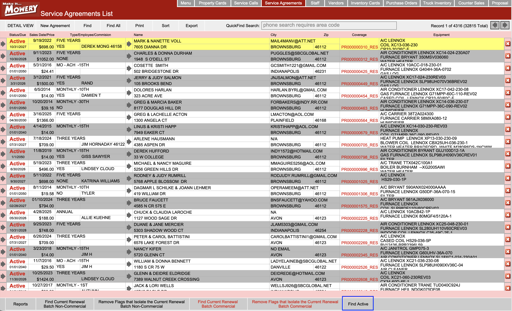
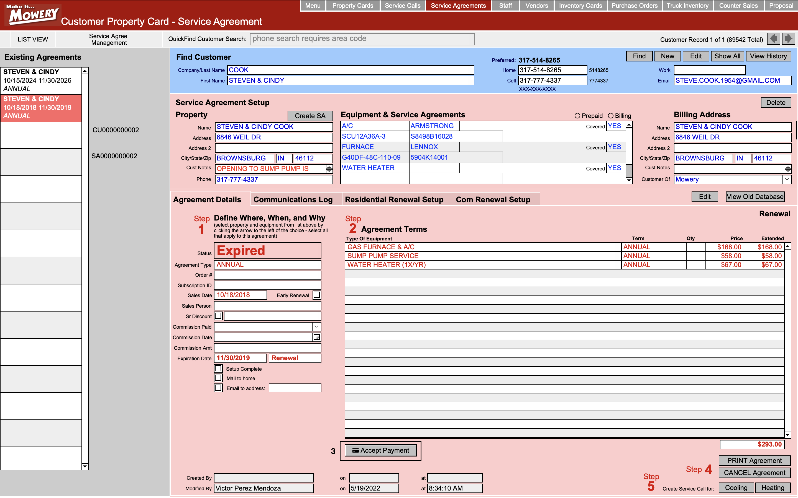

# Service Agreements

The **Service Agreements** section allows you to create and manage long-term service contracts between Mowery and its customers.  
Service agreements ensure customers receive ongoing service while providing Mowery with predictable revenue.

---
## Purpose

Use this section to create, update, and manage service agreements for customer properties.

---

## Key Features

- Create **Service Agreement (SA)** installment letters
    
- Generate **renewal proposals** for existing agreements
    
- View **expired**, **active**, or **soon-to-expire** service agreements
    
- **Print** service agreements
    

---
# Accept Payment for Service Agreements

This guide explains how to record a payment for a service agreement.

1. From the main menu, select **Service Agreements**.
    
2. In the list on the left, choose the agreement you want to update.

	Note: Use the navigation tabs below to filter results in the Service Agreements list.
	Click Find Active to display active service agreements.
	

	

  

3. In the **Agreement Details** section (Step 2), click **Accept Payment**.
    

  

---

## Fill Out the Payment Form

In the **Accept Payment** window, enter the following details:

|Field|Description|
|---|---|
|**Payment Type**|Select the payment method (e.g., **Card**, **ACH**).      **If Card:** Enter the card number, expiration date, and CVV.      **If ACH:** Enter the account name, account number, routing number, and account type.|
|**Amount**|Enter the exact amount received.|
|**Description**|_(Optional)_ Add any notes about the payment.|
|**Transaction ID**|Enter a reference number, such as a check number or electronic payment ID.|

---

## Complete the Payment

1. Click **Accept Payment** to save the transaction.
    
2. Click **Cancel** to exit without saving.
    

After you click **Accept Payment**:

- A confirmation message appears:
    
    > **"This transaction has been approved."**
    
- Click **OK** to continue.
    

> ⚠️ **Important:** The transaction will fail if the card is expired.

Once approved, the payment is recorded in the customer’s agreement history and reflected in their balance.

---
# Create Batch Service Calls

## Overview

Use this guide to create batch service calls for a customer based on a service agreement, selected year, and duration.

## Prerequisites

- The customer must have a service agreement (SA).
    
- If the service agreement has expired, renew it before creating service calls.
    

## Procedure

### 1. Open the Service Agreement

1. Go to **Service Agreements**.
    
2. Select the customer's service agreement record.
    
3. Check the agreement status. If the agreement has expired, renew it to make it active before proceeding.
    

### 2. Start Creating Service Calls

1. In the selected service agreement, click **Cooling** or **Heating**, depending on the type of service call you want to create.
    
2. Complete the required fields:
    
    - **Year:** Enter the year for which you want to create service calls.
        
    - **Years Duration:** Enter the number of years to cover.
        
    - **Department:** Select the appropriate department.
        
    - **Description:** Enter a description of the service call.
        
3. Review the information to make sure it is correct.
    
4. Click **Create Service Call**.
    

### 3. Verify the Created Service Calls

1. Go to **Service Calls**.
    
2. Open the list view.
    
3. Search for the customer.
    
4. Review the results to confirm that the batch service calls were created for the selected year and duration.
    

**Expected result:** The Service Calls list displays the batch service calls created for the customer based on the selected year and duration.
## Terminology

|Term / Abbreviation|Definition|
|---|---|
|**SA**|_Service Agreement._ A contract for ongoing customer services.|
|**ACH**|_Automated Clearing House._ An electronic network for bank-to-bank payments.|
|**Transaction ID**|A unique reference number for a payment (e.g., check number or electronic ID).|
|**Agreement Details**|Section in a service agreement record where actions such as payments are managed.|
|**Installment Letter**|A letter showing the payment schedule for a service agreement.|
|**Renewal Proposal**|A document used to extend or renew a service agreement.|
